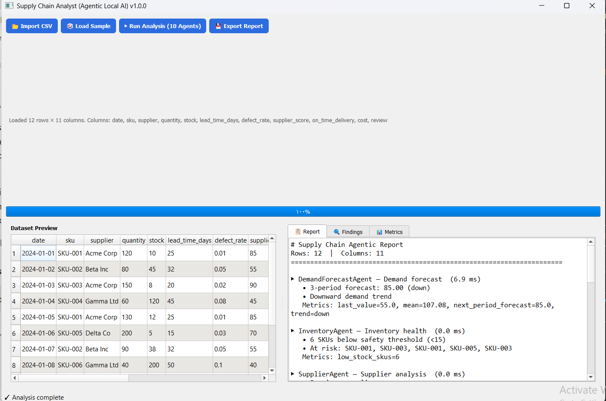

<h1>Supply Chain Analyst</h1>
  <h3>Agentic Local AI for Supply Chain Intelligence</h3>

  <p>
    <strong>A lightweight, offline, rule-based multi-agent analytical system</strong>
    <br/>
    Transform supply-chain CSV data into actionable operational insights.
  </p>

  <p>
    
    
    
    
  </p>

  <p>
    <a href="#features">Features</a> •
    <a href="#architecture">Architecture</a> •
    <a href="#technology-stack">Tech Stack</a> •
    <a href="#installation">Installation</a> •
    <a href="#usage">Usage</a>
  </p>

</div>
<div align="center">
  
  <p><em>Supply Chain Analyst — Application Preview</em></p>
</div>
---

**A Local, Offline, Rule-Based Multi-Agent Decision Support System for Supply Chain Analytics**

**Version:** 1.0.0  
**Document Type:** Product Requirements Document (PRD) / Technical README  
**Date:** November 16, 2026  
**Author:** Osama AlWaly  
**Status:** Version 1.0 — Baseline Specification

---

*Google Docs import: Copy this document into Google Docs using Paste, or use File → Open → Upload for a Markdown file. Apply Title, Heading 1, Heading 2, and Heading 3 styles to the corresponding Markdown heading levels. Recommended page settings: A4, Calibri 11 pt, 1.15 line spacing.*

---

# 1. Executive Summary

Supply Chain Analyst — Agentic Local AI with PyQt is a desktop-based analytical decision-support application designed to transform raw supply-chain CSV data into structured business intelligence through a collection of specialized, rule-based software agents.

Small and medium-sized enterprises (SMEs) frequently operate with fragmented operational information, limited analytical infrastructure, and insufficient access to specialized data science resources. Although supply-chain management systems generate substantial amounts of operational data, converting this information into actionable insights remains difficult.

The project addresses this problem through a lightweight local application that performs automated analysis without requiring cloud infrastructure, external large language model (LLM) APIs, GPU acceleration, or model downloads.

The system uses ten specialized analytical agents, each responsible for a particular supply-chain domain:

- Demand forecasting.
- Inventory analysis.
- Supplier performance.
- Logistics performance.
- Risk assessment.
- Sentiment analysis.
- Cost analysis.
- Quality analysis.
- Lead-time analysis.
- Anomaly detection.

Each agent inherits from a shared `BaseAgent` abstraction and returns a standardized result containing its identity, summary, findings, metrics, and execution time.

An `AgentEngine` coordinates execution, while a JSON-based `KnowledgeBase` stores configurable analytical rules. A centralized `THRESHOLDS` configuration defines important operational boundaries. The `RiskAgent` combines weighted rule evaluations into an overall risk score between 0 and 100.

The desktop interface is implemented using PyQt5. Users can load their own CSV files or a supplied sample dataset, preview the data, execute analysis, monitor progress, inspect reports and findings, and export results.

The technology stack consists of Python 3.11/3.12, PyQt5 5.15.11, pandas 2.2.3, NumPy 2.1.3, scikit-learn 1.5.2, and matplotlib 3.9.2.

The initial release prioritizes analytical transparency, low resource consumption, maintainability, and offline operation. The architecture also provides a foundation for expanding the system to twenty specialized agents and introducing optional local language-model integration in later releases.

The primary objective is not to replace enterprise supply-chain management platforms. It is to provide an accessible analytical layer that helps operational users understand their data, identify potential problems, and prioritize investigation.

# 2. Problem Statement

## 2.1 The Supply-Chain Visibility Gap

Supply chains generate operational data across purchasing, inventory, transportation, suppliers, production, and customer transactions.

However, collecting data does not automatically create visibility.

Organizations may possess transaction histories, supplier records, delivery information, inventory snapshots, and cost records without having a unified analytical process to interpret them.

This creates a visibility gap between available information and operational decision-making.

Typical consequences include:

- Delayed identification of inventory shortages.
- Inconsistent supplier performance evaluations.
- Limited understanding of delivery delays.
- Difficulty identifying unusual transaction patterns.
- Poor visibility into operational cost variations.
- Dependence on manually prepared spreadsheets.

Large organizations may address these challenges through enterprise resource planning systems, dedicated business intelligence platforms, and specialized analytical teams.

Smaller organizations often lack the budget and technical resources required to implement comparable infrastructure.

**Problem → Solution**

- Fragmented operational data → Centralized CSV ingestion.
- Limited analytical resources → Automated specialized agents.
- Delayed identification of risks → Rule-based risk evaluation.
- Difficult interpretation → Structured findings and reports.

## 2.2 Why Cloud-LLM-Only Tools Fall Short for SMEs

Cloud-based AI assistants can provide flexible analytical explanations, but depending exclusively on external language-model services introduces several limitations.

**Privacy:** Supply-chain datasets may contain supplier identities, purchasing prices, commercial agreements, and operational information. Uploading such information to external services may conflict with organizational data policies.

**Operating cost:** API usage introduces recurring expenses that can increase with dataset size and analysis frequency.

**Connectivity:** Cloud-dependent workflows require stable internet access and may become unavailable when connectivity is interrupted.

**Reproducibility:** Language-model responses may vary between executions, making it difficult to guarantee consistent rule-based evaluations.

**Resource dependency:** Some AI solutions require model downloads, GPU resources, or complex infrastructure.

These limitations are particularly relevant to organizations that need predictable, affordable, and locally controlled analytical tools.

Supply Chain Analyst adopts a different approach: analytical intelligence is implemented primarily through deterministic algorithms, statistical calculations, configurable rules, and specialized agents.

The system does not require an external LLM API.

**Problem → Solution**

- External data exposure → Local dataset processing.
- Recurring API expenses → Conventional local computation.
- Internet dependency → Offline analytical execution.
- Variable analytical behavior → Explicit rules and thresholds.

## 2.3 Pain Points of Manual CSV Analysis

CSV files are accessible and widely supported, but manual analysis becomes increasingly difficult as datasets grow.

Users commonly need to:

1. Inspect column names and data types.
2. Identify missing values.
3. Convert dates and numeric fields.
4. Calculate operational metrics.
5. Group records by suppliers, products, or time periods.
6. Identify unusual observations.
7. Compare operational performance.
8. Prepare reports for management.

Performing these tasks repeatedly creates unnecessary analytical overhead.

Manual spreadsheet workflows also introduce risks such as inconsistent formulas, accidental modifications, duplicated calculations, and incorrect interpretations.

A reusable analytical pipeline reduces this repetition by applying consistent processing logic across datasets.

## 2.4 The Agentic AI Promise — Delivered Locally

The term **agentic AI** describes systems that divide complex objectives into specialized tasks and coordinate their execution toward a common result.

In this project, agentic behavior is implemented through specialized software agents rather than autonomous language-model reasoning.

Each agent:

- Receives a dataset and relevant configuration.
- Executes a defined analytical procedure.
- Produces findings and measurable metrics.
- Returns a standardized result.
- Operates independently within a coordinated analysis workflow.

The `AgentEngine` manages the execution sequence and combines the resulting information.

This design offers modularity without requiring an expensive or unpredictable AI infrastructure.

The system's intelligence comes from the interaction between statistical algorithms, analytical rules, thresholds, and domain-specific processing.

# 3. Goals and Non-Goals

## 3.1 Primary Goals

The project has the following measurable objectives:

| Goal | Target |
|---|---|
| Local execution | No external LLM API dependency |
| Dataset processing | Typical analysis of 10,000 rows in under 5 seconds |
| Agent coverage | Ten operational agents in v1.0 |
| Extensibility | Architecture capable of supporting twenty agents |
| Reporting | Markdown and CSV output |
| Data accessibility | Standard CSV input |
| Risk evaluation | Weighted score from 0 to 100 |
| User experience | Dataset preview, progress monitoring, and three result tabs |
| Offline operation | Core analytical workflow functions without internet access |

## 3.2 Secondary Goals

- Provide understandable analytical findings.
- Encourage reusable statistical utilities.
- Separate business rules from execution logic.
- Support configurable thresholds.
- Minimize unnecessary dependencies.
- Establish a maintainable architecture for future extensions.
- Support future visualization and conversational interaction.

## 3.3 Explicit Non-Goals

The first release does not aim to:

- Replace ERP or warehouse management systems.
- Provide a complete enterprise supply-chain platform.
- Guarantee future demand or delivery outcomes.
- Perform autonomous procurement or purchasing transactions.
- Require external LLM services.
- Train deep-learning models.
- Require GPU acceleration.
- Provide multi-user cloud synchronization.
- Replace human operational decision-making.

**Problem → Solution**

- Excessive initial scope → Ten clearly defined v1 agents.
- Uncontrolled AI dependencies → Deterministic analytical engine.
- Enterprise-level infrastructure requirements → Lightweight desktop application.
- Unclear success criteria → Quantifiable performance and coverage targets.

# 4. Target Users and Personas

## 4.1 Supply-Chain Analyst at a Mid-Size Manufacturer

**Profile:** An analyst responsible for monitoring purchasing, inventory, supplier performance, and delivery operations.

**Challenges:**

- Multiple operational CSV files.
- Repetitive spreadsheet calculations.
- Difficulty identifying performance deterioration.
- Time-consuming report preparation.

**Expected value:** Automated analysis, consistent metrics, and faster identification of operational issues.

## 4.2 Procurement Manager

**Profile:** A manager responsible for purchasing decisions, supplier relationships, and procurement cost control.

**Challenges:**

- Inconsistent supplier performance.
- Unclear purchasing cost variations.
- Difficulty comparing supplier reliability.
- Limited visibility into delivery delays.

**Expected value:** Supplier comparisons, cost indicators, risk findings, and lead-time analysis.

## 4.3 Operations Lead at an SME

**Profile:** An operations professional responsible for coordinating daily activities with limited analytical resources.

**Challenges:**

- Limited technical expertise.
- Dependence on manual reporting.
- Insufficient visibility into operational problems.
- Limited access to expensive analytical software.

**Expected value:** An accessible desktop application that converts operational datasets into understandable findings.

# 5. Solution Overview

## 5.1 High-Level Architecture

The application follows a modular architecture consisting of three primary analytical layers.

**Tier 1: PyQt Frontend**

The frontend provides the desktop interaction layer.

Responsibilities include:

- Loading CSV datasets.
- Displaying dataset previews.
- Initiating analysis.
- Showing execution progress.
- Presenting reports, findings, and metrics.
- Exporting analytical results.

The frontend communicates with the backend rather than implementing analytical business logic directly.

**Tier 2: Rule-Based Agent Engine**

The backend coordinates analytical execution.

Its primary components are:

- `AgentEngine`
- `BaseAgent`
- Specialized agents
- `ReportGenerator`
- Reusable tools

The engine executes registered agents and collects their results.

**Tier 3: Knowledge Base**

The knowledge layer contains configurable business rules and analytical parameters.

Rules are stored in JSON and can be enriched dynamically using:

`KnowledgeBase.add_rule()`

The engine and agents use this information to evaluate operational conditions.

The centralized `THRESHOLDS` dictionary provides additional configuration for analytical boundaries.

## 5.2 Why Local, Rule-Based Agents?

The architecture prioritizes four operational characteristics.

**Privacy:** Data remains within the local processing environment.

**Cost efficiency:** No external LLM API usage is required for standard analysis.

**Low latency:** Statistical operations execute locally without network communication.

**Offline availability:** Once the application and dependencies are installed, the core analysis workflow does not require internet connectivity.

The deterministic design also improves explainability because findings can be associated with identifiable calculations and explicit rules.

## 5.3 Technology Stack

| Technology | Version | Responsibility |
|---|---|---|
| Python | 3.11/3.12 | Application runtime |
| PyQt5 | 5.15.11 | Desktop interface |
| pandas | 2.2.3 | Dataset processing |
| NumPy | 2.1.3 | Numerical computation |
| scikit-learn | 1.5.2 | Supporting analytical algorithms |
| matplotlib | 3.9.2 | Visualization support |
| JSON | Standard | Knowledge-base storage |

The application does not require GPU acceleration or external language-model services.

# 6. Feature Catalogue

## 6.1 Data Ingestion

The ingestion layer provides the entry point for operational datasets.

**CSV Import**

Users can select a CSV file from their local filesystem.

The application reads the dataset into a pandas DataFrame for subsequent processing.

**Sample Dataset**

A supplied `sample.csv` allows users to test the application without preparing their own data.

**Schema Preview**

Before analysis, users can inspect the imported dataset.

The preview helps identify:

- Column names.
- Available records.
- Data structure.
- Potential compatibility problems.

The ingestion layer should validate the dataset before passing it to the agent engine.

## 6.2 Version 1.0 — Ten Specialized Agents

All v1 agents inherit from `BaseAgent` and follow a shared execution contract.

Each agent returns:

`{agent, summary, findings, metrics, elapsed_ms}`

This standardized interface allows the engine to coordinate different analytical procedures without requiring agent-specific handling.

### 6.2.1 DemandForecastAgent

**Purpose:** Analyze historical demand and identify potential future demand patterns.

**Inputs:** Historical transaction quantities, dates, and product identifiers when available.

**Algorithm:** Time-based aggregation, descriptive statistics, trend analysis, and supported forecasting procedures.

**Outputs:**
- Demand summaries.
- Historical trends.
- Forecast-related metrics.
- Potential demand fluctuations.

**Business Value:** Supports inventory planning and demand-related decisions.

### 6.2.2 InventoryAgent

**Purpose:** Evaluate inventory-related operational conditions.

**Inputs:** Available stock quantities, product identifiers, transaction quantities, and demand information when available.

**Algorithm:** Stock aggregation, inventory comparisons, threshold evaluation, and reorder-related calculations when the required fields exist.

**Outputs:**
- Inventory indicators.
- Potential shortage findings.
- Stock-related metrics.
- Reorder alerts.

**Business Value:** Helps identify potential stock shortages and excessive inventory.

### 6.2.3 SupplierAgent

**Purpose:** Evaluate supplier performance and identify operational weaknesses.

**Inputs:** Supplier identifiers, purchasing transactions, quantities, costs, and delivery information when available.

**Algorithm:** Supplier-level aggregation, comparative statistics, performance indicators, and configurable rule evaluation.

**Outputs:**
- Supplier summaries.
- Comparative metrics.
- Supplier-related findings.
- Potential performance concerns.

**Business Value:** Supports supplier evaluation and procurement decisions.

### 6.2.4 LogisticsAgent

**Purpose:** Examine transportation and delivery-related operational performance.

**Inputs:** Delivery records, shipment information, transportation costs, and available logistics dates.

**Algorithm:** Aggregation, descriptive statistics, delay evaluation, and comparisons across available logistics attributes.

**Outputs:**
- Logistics performance summaries.
- Delivery-related findings.
- Transportation indicators.

**Business Value:** Helps identify operational inefficiencies and potential delivery problems.

### 6.2.5 RiskAgent

**Purpose:** Consolidate operational risk indicators into a weighted risk score.

**Inputs:** Relevant findings, JSON knowledge rules, and configured thresholds.

**Algorithm:** Weighted rule evaluation and aggregation.

The agent produces an overall risk score on a scale from 0 to 100.

The score represents the result of the configured analytical model. It should not be interpreted as a statistically calibrated probability of failure.

**Outputs:**
- Overall risk score.
- Risk-related findings.
- Triggered rule information.
- Supporting metrics.

**Business Value:** Provides a consolidated view of operational concerns and helps prioritize investigation.

### 6.2.6 SentimentAgent

**Purpose:** Analyze available textual feedback and identify positive or negative language patterns.

**Inputs:** Textual descriptions, comments, or feedback fields.

**Algorithm:** Local lexicon-based classification using positive and negative word sets.

The implementation does not require TextBlob or an external NLP service.

**Outputs:**
- Sentiment classifications.
- Positive and negative indicators.
- Text-related summaries.

**Business Value:** Helps identify recurring concerns in available textual feedback.

### 6.2.7 CostAgent

**Purpose:** Evaluate financial and purchasing cost patterns.

**Inputs:** Unit prices, transaction quantities, and other available cost-related columns.

**Algorithm:** Descriptive statistics, aggregation, cost comparisons, and threshold-based evaluations.

**Outputs:**
- Cost summaries.
- Price-related findings.
- Cost variation metrics.
- Potential cost anomalies.

**Business Value:** Supports purchasing cost monitoring and financial investigation.

### 6.2.8 QualityAgent

**Purpose:** Identify quality-related patterns and potential operational quality issues.

**Inputs:** Available quality indicators, defect records, product descriptions, and relevant transaction attributes.

**Algorithm:** Descriptive statistics, grouping, comparisons, and configurable quality rules.

**Outputs:**
- Quality summaries.
- Potential quality findings.
- Relevant metrics.

**Business Value:** Helps identify recurring quality concerns and prioritize further inspection.

### 6.2.9 LeadTimeAgent

**Purpose:** Analyze the time required for operational processes and deliveries.

**Inputs:** Order dates, shipment dates, delivery dates, and other relevant timestamps when available.

**Algorithm:** Date conversion, elapsed-time calculation, aggregation, and statistical comparison.

**Outputs:**
- Lead-time summaries.
- Delay-related indicators.
- Variability metrics.

**Business Value:** Supports supplier reliability assessment and operational scheduling.

### 6.2.10 AnomalyAgent

**Purpose:** Identify unusual observations across numeric dataset columns.

**Inputs:** Numeric columns from the imported DataFrame.

**Algorithm:** Interquartile Range (IQR).

For each applicable numeric column:

\[
IQR = Q_3-Q_1
\]

The lower and upper boundaries are:

\[
L=Q_1-1.5(IQR)
\]

\[
U=Q_3+1.5(IQR)
\]

Observations outside these boundaries are flagged as potential anomalies.

**Outputs:**
- Detected outliers.
- Affected columns.
- Anomaly counts.
- Statistical summaries.

**Business Value:** Helps identify unusual transactions, quantities, prices, or other numeric observations.

An anomaly is not automatically an error or fraud indicator. Business context is required before taking action.

## 6.3 Version 2.0 Agent Expansion — Ten Additional Agents

The architecture is designed to support ten additional specialized agents.

| Agent | Purpose | Inputs and analytical approach | Expected outputs and business value |
|---|---|---|---|
| WarehouseAgent | Evaluate warehouse operations | Storage, stock movement, and location data; aggregation and utilization analysis | Warehouse efficiency indicators |
| SourcingAgent | Evaluate sourcing alternatives | Supplier, purchasing, and sourcing records; comparative analysis | Sourcing recommendations |
| PricingAgent | Examine pricing patterns | Product prices and transaction data; price distribution and comparisons | Pricing insights |
| ReturnsAgent | Analyze product returns | Return records, quantities, and product identifiers; return-rate calculations | Returns indicators |
| ComplianceAgent | Evaluate compliance-related records | Available regulatory and operational fields; rule-based validation | Potential compliance findings |
| GeographyAgent | Analyze geographical distribution | Location, country, and regional attributes; grouping and comparisons | Geographic performance summaries |
| CapacityAgent | Examine operational capacity | Production, inventory, or throughput data; utilization calculations | Capacity indicators |
| CarbonAgent | Estimate environmental indicators | Transportation, quantities, and available emission factors | Estimated environmental metrics |
| ForecastBiasAgent | Evaluate forecasting accuracy | Historical forecasts and actual observations; bias and error calculations | Forecast quality indicators |
| SegmentAgent | Group operational entities | Product, customer, supplier, and transaction attributes; statistical segmentation | Segment-level analytical insights |

These agents are roadmap components, not part of the initial ten-agent implementation.

Their actual functionality depends on the availability and quality of the corresponding input fields.

## 6.4 Tools Layer

The tools layer contains reusable functionality shared across agents.

| Module | Responsibility | Typical operations |
|---|---|---|
| `stats_tools` | Statistical calculations | Aggregations, descriptive statistics, distributions |
| `text_tools` | Text processing | Normalization, tokenization, lexicon matching |
| `time_tools` | Temporal operations | Date parsing, elapsed-time calculations, grouping |
| `validation_tools` | Data validation | Required-column checks, type validation, missing-value inspection |
| `chart_tools` | Visualization support | Chart preparation and reusable plotting helpers |

The tools layer prevents agents from repeatedly implementing the same low-level operations.

This separation also makes testing and maintenance easier.

## 6.5 Knowledge Base

The knowledge base stores operational rules in:

`knowledge/supply_chain_rules.json`

Rules can contain:

- Rule identifiers.
- Descriptions.
- Relevant analytical conditions.
- Thresholds.
- Weights.
- Associated operational categories.

The `KnowledgeBase` component loads and exposes the stored rules.

Runtime enrichment is supported through:

`KnowledgeBase.add_rule()`

This mechanism allows additional rules to be introduced without redesigning the complete agent architecture.

The `RiskAgent` consumes relevant rules and combines weighted evaluations into a score between 0 and 100.

## 6.6 Reporting

The reporting layer converts analytical results into readable and reusable outputs.

**Markdown Reports**

Markdown reports organize the analysis into structured sections, including:

- Analysis overview.
- Agent summaries.
- Findings.
- Important metrics.
- Execution information.

**CSV Export**

CSV export allows users to preserve structured analytical results for subsequent spreadsheet or data-processing workflows.

The reporting layer is implemented through the backend `ReportGenerator`.

## 6.7 Frontend

The initial PyQt5 interface provides the following functionality:

| Component | Responsibility |
|---|---|
| Dataset loader | Import local CSV files |
| Sample loader | Load the supplied dataset |
| Dataset preview | Inspect imported records |
| Analysis control | Start the analytical workflow |
| Progress bar | Display execution progress |
| Report tab | Display the generated report |
| Findings tab | Display agent findings |
| Metrics tab | Display structured analytical metrics |
| Export control | Export CSV results |

The v1.2 interface roadmap introduces additional dashboard KPIs, charts, a chat-style query panel, and settings functionality.

# 7. Functional Requirements

Functional requirements define the expected behavior of the application.

Priorities:

- **P0:** Essential for the core release.
- **P1:** Important enhancement.
- **P2:** Future extension.

| FR-ID | Description | Priority | Acceptance Criteria |
|---|---|---|---|
| FR-001 | Import CSV datasets | P0 | A valid CSV can be loaded successfully |
| FR-002 | Load sample dataset | P0 | Supplied sample data can be opened |
| FR-003 | Preview dataset | P0 | Imported records and columns are displayed |
| FR-004 | Validate dataset | P0 | Invalid or incompatible input is identified |
| FR-005 | Execute agent engine | P0 | Registered agents execute through the engine |
| FR-006 | Implement BaseAgent | P0 | Agents follow a shared execution contract |
| FR-007 | Implement ten v1 agents | P0 | All ten agents are registered and executable |
| FR-008 | Generate findings | P0 | Agents return structured findings |
| FR-009 | Generate metrics | P0 | Agent results contain structured metrics |
| FR-010 | Measure execution time | P0 | Results include elapsed milliseconds |
| FR-011 | Calculate risk score | P0 | RiskAgent returns a score between 0 and 100 |
| FR-012 | Load JSON rules | P0 | KnowledgeBase loads the configured JSON file |
| FR-013 | Enrich knowledge base | P1 | New rules can be added at runtime |
| FR-014 | Generate Markdown reports | P0 | ReportGenerator produces readable Markdown |
| FR-015 | Export CSV results | P0 | Structured results can be exported |
| FR-016 | Monitor progress | P0 | UI displays analysis progress |
| FR-017 | Display three result tabs | P0 | Report, Findings, and Metrics are accessible |
| FR-018 | Provide reusable tools | P1 | Shared utility modules are available |
| FR-019 | Introduce dashboard KPIs | P1 | Dashboard displays selected operational metrics |
| FR-020 | Introduce charts | P1 | Supported results can be visualized |
| FR-021 | Introduce chat-style query panel | P1 | Users can interact with the supported analytical interface |
| FR-022 | Introduce settings | P1 | Configurable application settings are accessible |
| FR-023 | Support additional agents | P1 | New agents can be registered through the established interface |
| FR-024 | Optional local LLM integration | P2 | A local model can be integrated without making it mandatory |

# 8. Non-Functional Requirements

## 8.1 Performance

The application should process typical datasets containing up to 10,000 rows in under five seconds.

Actual execution time depends on the number of columns, data types, algorithms, and enabled agents.

## 8.2 Memory Footprint

The application should avoid unnecessary copies of large DataFrames and should reuse intermediate calculations when practical.

The initial design targets ordinary desktop environments rather than GPU-equipped workstations.

## 8.3 Offline Behavior

Core ingestion, analytical execution, and reporting must function without internet connectivity after installation.

No external LLM API is required.

## 8.4 Extensibility

New agents should follow the `BaseAgent` interface and be registered through `agents/__init__.py` and `ALL_AGENTS`.

New knowledge rules should be introduced through the JSON store or the supported runtime enrichment method.

## 8.5 Portability

The application targets Python 3.11/3.12 environments with compatible dependency versions.

Windows is an important deployment environment.

## 8.6 Security and Privacy

- Process datasets locally.
- Avoid transmitting operational information externally.
- Do not embed credentials in application configuration.
- Validate imported files.
- Handle malformed data safely.
- Avoid executing imported content as code.

## 8.7 User Experience

The interface should provide clear import, execution, progress, results, and export workflows.

Errors should communicate what failed and, where possible, how to correct it.

# 9. Architecture and Design

## 9.1 Directory Layout

The logical project structure is organized as follows:

```text
supply-chain-analyst/
│
├── frontend/
│   ├── __init__.py
│   ├── main_window.py
│   ├── widgets/
│   ├── dashboard/
│   ├── charts/
│   ├── chat/
│   └── settings/
│
├── backend/
│   ├── __init__.py
│   ├── base_agent.py
│   ├── agent_engine.py
│   ├── knowledge_base.py
│   └── report_generator.py
│
├── agents/
│   ├── __init__.py
│   ├── demand_forecast.py
│   ├── inventory.py
│   ├── supplier.py
│   ├── logistics.py
│   ├── risk.py
│   ├── sentiment.py
│   ├── cost.py
│   ├── quality.py
│   ├── lead_time.py
│   └── anomaly.py
│
├── tools/
│   ├── __init__.py
│   ├── stats_tools.py
│   ├── text_tools.py
│   ├── time_tools.py
│   ├── validation_tools.py
│   └── chart_tools.py
│
├── knowledge/
│   └── supply_chain_rules.json
│
├── data/
│   └── sample.csv
│
├── reports/
│
├── config.py
├── main.py
├── requirements.txt
└── README.md
```

This is the logical architecture. Optional directories and modules may be introduced as individual features are implemented.

## 9.2 Data Flow

The application follows this analytical sequence:

```text
User
  |
  v
PyQt5 Frontend
  |
  v
CSV Ingestion
  |
  v
Dataset Validation
  |
  v
DataFrame
  |
  v
AgentEngine
  |
  +---- DemandForecastAgent
  |
  +---- InventoryAgent
  |
  +---- SupplierAgent
  |
  +---- LogisticsAgent
  |
  +---- RiskAgent
  |
  +---- SentimentAgent
  |
  +---- CostAgent
  |
  +---- QualityAgent
  |
  +---- LeadTimeAgent
  |
  +---- AnomalyAgent
  |
  v
KnowledgeBase + THRESHOLDS
  |
  v
Structured Agent Results
  |
  v
ReportGenerator
  |
  +---- Markdown Report
  |
  +---- CSV Export
  |
  v
Frontend Result Tabs
```

The knowledge base and configuration supply rules and thresholds to the relevant analytical components.

## 9.3 Agent Lifecycle

All specialized agents follow a shared lifecycle.

**Step 1 — Initialization**

An agent is instantiated through the engine's registration mechanism.

**Step 2 — Input Reception**

The agent receives the dataset and required configuration.

**Step 3 — Validation**

The agent verifies that the required information is available.

**Step 4 — Execution**

The agent performs its specific analytical procedure.

**Step 5 — Result Construction**

The agent generates a standardized result.

**Step 6 — Collection**

The engine collects the result for reporting.

A representative result structure is:

```python
{
    "agent": "DemandForecastAgent",
    "summary": "Demand analysis completed",
    "findings": [],
    "metrics": {},
    "elapsed_ms": 125.4
}
```

The values above are illustrative, not benchmark measurements.

This standardized contract simplifies orchestration, testing, and future agent development.

## 9.4 Rule-Based Intelligence Model

The analytical intelligence model uses two complementary sources:

1. The centralized `THRESHOLDS` dictionary.
2. The JSON-based knowledge rules.

Thresholds define configurable analytical boundaries.

Knowledge rules describe business conditions and their associated weights.

The RiskAgent evaluates applicable rules and aggregates their weighted results.

Conceptually:

\[
R=\operatorname{Aggregate}(r_1w_1,r_2w_2,\ldots,r_nw_n)
\]

The final score is constrained to:

\[
0\leq R\leq100
\]

The exact aggregation, normalization, and weighting behavior must remain consistent with the implemented risk algorithm.

The score is an analytical indicator rather than a guarantee of actual operational loss.

## 9.5 Resource-Efficient Design

The system deliberately avoids infrastructure that is unnecessary for its initial analytical objectives.

Its resource-efficient characteristics include:

- No external LLM API.
- No GPU requirement.
- No model downloads.
- No mandatory cloud infrastructure.
- pandas-based data processing.
- NumPy-based numerical calculations.
- Reusable utility functions.
- Sequential agent execution.
- Limited unnecessary DataFrame copying.

Agent execution is designed as a single-threaded per-agent loop.

The UI can use a QThread worker to keep the graphical interface responsive while the analysis executes.

This distinction is important: background execution protects interface responsiveness without requiring parallel execution of every agent.

# 10. User Journey and Walkthrough

The expected workflow is designed to minimize the number of steps between importing data and understanding the analytical results.

## Step 1 — Installation

The user prepares a supported Python environment and installs the required dependencies.

```powershell
py -3.12 -m venv .venv
.\.venv\Scripts\Activate.ps1
python -m pip install --upgrade pip
pip install -r requirements.txt
```

## Step 2 — Launch

The user starts the application:

```powershell
python main.py
```

The PyQt5 main window opens.

## Step 3 — Load CSV

The user selects a local CSV file or loads the supplied sample dataset.

The application reads the file and prepares the DataFrame.

## Step 4 — Inspect Dataset

The dataset preview displays the available columns and records.

The user can inspect the imported information before analysis.

## Step 5 — Execute Analysis

The user starts the analytical workflow.

The engine executes the registered agents and the frontend displays progress.

## Step 6 — Review Report

The Report tab presents the generated Markdown report.

The user can inspect the overall analysis and agent summaries.

## Step 7 — Review Findings

The Findings tab presents the issues, observations, and potential risks identified by the agents.

## Step 8 — Review Metrics

The Metrics tab presents numerical indicators and execution-related measurements.

## Step 9 — Export

The user exports structured CSV results for further analysis or recordkeeping.

# 11. Known Issues and Troubleshooting

The following problems were encountered during development and environment preparation.

| Problem | Root Cause | Solution |
|---|---|---|
| `meson.build:2:0: ERROR: Could not parse vswhere.exe output` | Installing pandas 2.2.2 under Python 3.13 attempted a source build because a compatible wheel was unavailable. The local MSVC toolchain failed during configuration. | Use Python 3.11 or 3.12 with pandas 2.2.3 prebuilt wheels. Alternatively, use `pip install --only-binary=:all:` to prevent unexpected source builds. |
| `ModuleNotFoundError: No module named 'agents.demand_forecast'` | Agent files were missing or empty because a PowerShell heredoc-writing operation failed silently. | Rewrite each file using `@' ... '@ \| Out-File -Encoding utf8 agents\<name>.py`. Verify that files exist and have nonzero lengths using `Get-ChildItem`. |
| `JSONDecodeError: Unexpected UTF-8 BOM` | Windows PowerShell 5.x `Out-File -Encoding utf8` writes a UTF-8 BOM, which can interfere with standard JSON loading. | Read JSON with `encoding='utf-8-sig'` in `knowledge_base.py`. Write JSON using .NET `UTF8Encoding($false)` to avoid the BOM. |
| PowerShell virtual environment activation is blocked | The execution policy prevents running the activation script. | Use `Set-ExecutionPolicy -Scope Process -ExecutionPolicy Bypass` for the current PowerShell session, or execute the environment's Python directly. |
| PyQt5 DLL loading error | Incompatible Python environment, incomplete installation, or conflicting Qt libraries. | Reinstall the compatible PyQt5 package in the active virtual environment and verify that the selected Python interpreter is correct. |
| Matplotlib backend initialization error | Incompatible GUI backend or Qt configuration. | Use a compatible Qt backend such as `QtAgg` where appropriate and verify that PyQt5 and matplotlib are installed in the same environment. |

## 11.1 pandas Installation Failure

The most important environment issue occurred when attempting to install pandas 2.2.2 using Python 3.13.

The absence of a compatible wheel caused pip to attempt a source build.

The build process encountered a Meson configuration error involving `vswhere.exe`.

The recommended environment uses Python 3.11 or 3.12 and pandas 2.2.3.

## 11.2 Missing Agent Modules

The application depends on consistent module naming and registration.

A file can exist but still be unusable if it is empty or contains incomplete code.

Verify agent files:

```powershell
Get-ChildItem .\agents\*.py |
    Select-Object Name, Length
```

Check that all expected modules are present and that `agents/__init__.py` correctly registers them in `ALL_AGENTS`.

## 11.3 JSON Encoding

To avoid BOM-related parsing problems, use:

```python
with open(
    "knowledge/supply_chain_rules.json",
    "r",
    encoding="utf-8-sig"
) as file:
    rules = json.load(file)
```

For BOM-free JSON writing in Windows PowerShell:

```powershell
$utf8NoBom = New-Object System.Text.UTF8Encoding($false)

[System.IO.File]::WriteAllText(
    "knowledge/supply_chain_rules.json",
    $jsonContent,
    $utf8NoBom
)
```

## 11.4 General Environment Verification

Before investigating application-level errors, verify:

- The active Python interpreter.
- Installed dependency versions.
- Virtual environment activation.
- File existence.
- Package initialization files.
- Import paths.
- JSON encoding.
- Qt and matplotlib compatibility.

A consistent environment reduces the likelihood of confusing installation failures with application defects.

# 12. Roadmap

## v1.0 — Core Analytical Application

**Status: Delivered baseline**

Scope:

- Ten specialized analytical agents.
- PyQt5 desktop interface.
- CSV import.
- Sample dataset.
- Dataset preview.
- Progress monitoring.
- Report, Findings, and Metrics tabs.
- Markdown report generation.
- CSV export.
- JSON-based knowledge base.
- Configurable thresholds.

## v1.1 — Analytical Expansion

Scope:

- Ten additional specialized agents.
- Completion of the reusable tools layer.
- Improved rule enrichment.
- Expanded analytical coverage.
- Additional validation and integration tests.

## v1.2 — Enhanced User Interface

Scope:

- Dashboard KPIs.
- Expanded charts.
- Chat-style query panel.
- Application settings.
- Improved result navigation.

## v1.3 — Optional Local LLM Integration

Scope:

- Optional local language-model integration.
- Potential llama.cpp integration.
- Tool-calling architecture.
- Natural-language interpretation of existing analytical results.

This integration must remain optional. The original rule-based analytical engine must continue functioning independently.

## v2.0 — Persistent and Collaborative Operation

Scope:

- Persistent analytical storage.
- Multi-user support.
- Scheduled analysis.
- Historical comparison.
- Expanded reporting workflows.

# 13. Success Metrics and KPIs

The following indicators define the initial performance and usability targets.

| KPI | Target | Measurement |
|---|---|---|
| Time to insight | Under 3 minutes | Time from application launch to accessible analytical findings |
| Analysis execution | Under 5 seconds for typical datasets up to 10K rows | Execution-time measurement |
| External network calls | Zero during core analysis | Network activity inspection |
| CSV schema acceptance | Above 90% for supported representative datasets | Accepted datasets divided by tested supported datasets |
| Agent execution coverage | 10 agents | Registered and successfully executed agents |
| Result consistency | Stable for identical inputs and configuration | Repeated execution comparison |
| Risk score validity | 0–100 | Automated boundary validation |
| Report generation | Successful Markdown and CSV output | Export integration tests |

Performance targets are engineering objectives and should be verified under a documented hardware and dataset configuration.

# 14. Testing and Validation Plan

Testing should verify both individual analytical components and the complete application workflow.

## 14.1 Unit Testing

Test individual functions and modules, including:

- Statistical calculations.
- Text-processing utilities.
- Time calculations.
- Validation helpers.
- Knowledge-base loading.
- Rule enrichment.
- Risk-score aggregation.

## 14.2 Agent Testing

Each agent should be tested with:

- Valid representative input.
- Missing required columns.
- Empty datasets.
- Missing values.
- Invalid data types.
- Unexpected numerical values.

Tests should verify that every agent returns the standardized result structure.

## 14.3 Integration Testing

Integration tests should cover:

- CSV ingestion.
- Dataset validation.
- Agent registration.
- AgentEngine execution.
- KnowledgeBase integration.
- ReportGenerator output.
- CSV export.

## 14.4 Sample Dataset Validation

The supplied sample dataset should act as a repeatable validation input.

Golden-result tests should verify stable expected metrics for fixed input data and configuration.

Changes to thresholds or analytical algorithms should trigger an intentional review of expected outputs.

## 14.5 Interface Testing

The desktop workflow should be tested from dataset loading through result export.

Particular attention should be paid to background execution, progress updates, error handling, and interface responsiveness.

# 15. Assumptions and Risks

## 15.1 Assumptions

- Users can provide CSV datasets.
- The datasets contain sufficient information for at least some analytical agents.
- Column names and data types can be validated.
- Python 3.11/3.12 environments are available.
- Required dependencies can be installed locally.
- Business thresholds can be configured.
- Users understand that analytical findings require operational interpretation.

## 15.2 Technical Risks

**Inconsistent CSV schemas**

Different organizations use different column names and formats.

Mitigation: validation utilities and clear compatibility reporting.

**Missing data**

Some agents may not receive all required information.

Mitigation: agent-level validation and graceful handling of unavailable analyses.

**Incorrect thresholds**

Poorly configured thresholds can produce misleading findings.

Mitigation: centralized configuration, documented assumptions, and validation.

**Statistical misinterpretation**

Anomalies and unusual patterns do not necessarily indicate operational failures.

Mitigation: distinguish observations from conclusions and recommendations.

**Performance degradation**

Large datasets and repeated operations may increase execution time and memory consumption.

Mitigation: efficient pandas operations, controlled DataFrame copying, and execution profiling.

**GUI responsiveness**

Long-running operations can block the main application thread.

Mitigation: background execution using a QThread worker.

**Dependency compatibility**

Python and third-party package versions can create installation problems.

Mitigation: supported runtime versions, pinned dependency versions, and reproducible installation instructions.

# 16. Glossary

| Term | Definition |
|---|---|
| Agent | A specialized software component responsible for a defined analytical task |
| Tool | A reusable function or module that supports analytical operations |
| Knowledge Rule | A configurable business condition used to evaluate operational data |
| ABC Analysis | Inventory classification based on relative consumption value or another selected importance measure |
| XYZ Analysis | Inventory classification based on demand variability and predictability |
| HHI | Herfindahl-Hirschman Index, a measure of market or supplier concentration |
| MAPE | Mean Absolute Percentage Error, a measure of forecasting error |
| IQR | Interquartile Range, calculated as the difference between the third and first quartiles |
| ROP | Reorder Point, the inventory level at which replenishment should be initiated |
| EOQ | Economic Order Quantity, a model for determining an economically appropriate order size |
| DataFrame | A two-dimensional labeled data structure provided by pandas |
| Threshold | A configured numerical or logical boundary used in analytical evaluation |
| Risk Score | A weighted analytical indicator representing the combined results of applicable risk rules |
| AgentEngine | The backend component responsible for coordinating agent execution |

# 17. Appendix A — File-by-File Manifest

The following manifest describes the logical responsibilities of the main project files.

```text
supply-chain-analyst/
│
├── main.py
│   └── Application entry point
│
├── config.py
│   └── Application metadata, paths, and thresholds
│
├── requirements.txt
│   └── Python dependency definitions
│
├── README.md
│   └── Project documentation and PRD
│
├── frontend/
│   ├── __init__.py
│   │   └── Frontend package initialization
│   ├── main_window.py
│   │   └── Main desktop application window
│   ├── widgets/
│   │   └── Reusable interface components
│   ├── dashboard/
│   │   └── Dashboard components (roadmap)
│   ├── charts/
│   │   └── Visualization components (roadmap)
│   ├── chat/
│   │   └── Query interface (roadmap)
│   └── settings/
│       └── Application settings (roadmap)
│
├── backend/
│   ├── __init__.py
│   │   └── Backend package initialization
│   ├── base_agent.py
│   │   └── Shared agent abstraction
│   ├── agent_engine.py
│   │   └── Agent orchestration
│   ├── knowledge_base.py
│   │   └── JSON rule loading and enrichment
│   └── report_generator.py
│       └── Markdown and structured report generation
│
├── agents/
│   ├── __init__.py
│   │   └── Agent imports and ALL_AGENTS registry
│   ├── demand_forecast.py
│   │   └── Demand analysis
│   ├── inventory.py
│   │   └── Inventory analysis
│   ├── supplier.py
│   │   └── Supplier performance
│   ├── logistics.py
│   │   └── Logistics analysis
│   ├── risk.py
│   │   └── Weighted risk evaluation
│   ├── sentiment.py
│   │   └── Local lexicon sentiment analysis
│   ├── cost.py
│   │   └── Cost analysis
│   ├── quality.py
│   │   └── Quality analysis
│   ├── lead_time.py
│   │   └── Lead-time analysis
│   └── anomaly.py
│       └── IQR-based anomaly detection
│
├── tools/
│   ├── __init__.py
│   │   └── Utility package initialization
│   ├── stats_tools.py
│   │   └── Statistical helpers
│   ├── text_tools.py
│   │   └── Text-processing helpers
│   ├── time_tools.py
│   │   └── Temporal-processing helpers
│   ├── validation_tools.py
│   │   └── Dataset validation
│   └── chart_tools.py
│       └── Visualization helpers
│
├── knowledge/
│   └── supply_chain_rules.json
│       └── Configurable analytical rules
│
├── data/
│   └── sample.csv
│       └── Demonstration dataset
│
└── reports/
    └── Generated analytical reports
```

The manifest represents the logical architecture and expected module responsibilities. It should be reconciled with the actual repository when maintaining the implementation documentation.

# 18. Appendix B — Sample Output Snippet

The following example illustrates the expected presentation format of a generated Markdown report. All figures are illustrative.

```markdown
# Supply Chain Analysis Report

## Analysis Overview

Dataset: sample.csv
Records: 10,000
Agents Executed: 10
Execution Time: 3,450 ms

## Agent Summaries

### DemandForecastAgent

Summary:
Historical demand patterns were analyzed.

Findings:
- Demand varies across observed periods.
- Additional forecasting validation is recommended.

### InventoryAgent

Summary:
Inventory-related indicators were evaluated.

Findings:
- Potential stock shortages require investigation.

### SupplierAgent

Summary:
Supplier performance was evaluated.

Findings:
- Supplier-level performance differences were identified.

### RiskAgent

Summary:
Operational risk rules were evaluated.

Risk Score: 62/100

Findings:
- Multiple configured risk conditions were triggered.

### AnomalyAgent

Summary:
Numeric columns were examined using IQR boundaries.

Findings:
- Potential outliers were identified in selected columns.

## Metrics

| Metric | Value |
|---|---:|
| Records Analyzed | 10,000 |
| Agents Executed | 10 |
| Risk Score | 62 |
| Execution Time | 3,450 ms |

## Conclusion

The analysis identified operational indicators
requiring further investigation.

Findings should be interpreted in the context
of the organization's actual supply-chain processes.
```

The generated report should distinguish observed results, calculated metrics, and suggested investigations.

# 19. Appendix C — PowerShell Setup Script

The following setup example assumes that Python 3.12 is installed and available through the Python launcher.

```powershell
# Supply Chain Analyst
# Environment Setup

$ErrorActionPreference = "Stop"

# Verify Python
py -3.12 --version

# Create virtual environment
py -3.12 -m venv .venv

# Activate environment
Set-ExecutionPolicy `
    -Scope Process `
    -ExecutionPolicy Bypass `
    -Force

.\.venv\Scripts\Activate.ps1

# Upgrade pip
python -m pip install --upgrade pip

# Install dependencies
python -m pip install `
    PyQt5==5.15.11 `
    pandas==2.2.3 `
    numpy==2.1.3 `
    scikit-learn==1.5.2 `
    matplotlib==3.9.2

# Verify installations
python -c "import PyQt5, pandas, numpy, sklearn, matplotlib; print('Dependencies OK')"

# Launch application
python main.py
```

If `requirements.txt` is maintained with the specified package versions, dependency installation can instead use:

```powershell
python -m pip install -r requirements.txt
```

---

# 20. Conclusion

Supply Chain Analyst — Agentic Local AI with PyQt establishes a lightweight analytical framework for converting supply-chain CSV data into structured operational insights.

Its architecture separates the desktop interface, analytical orchestration, specialized agents, reusable tools, and configurable knowledge rules.

The ten-agent foundation provides coverage across demand, inventory, suppliers, logistics, risk, sentiment, cost, quality, lead time, and anomalies.

The use of local statistical processing and deterministic rules minimizes external dependencies while preserving analytical transparency and predictable execution.

The project is designed to evolve incrementally. Additional agents, visualization capabilities, conversational interaction, optional local language-model integration, and persistent storage can be introduced without abandoning the original architecture.

The defining engineering principle is to make supply-chain analysis accessible, modular, explainable, and computationally efficient while keeping operational data under local control.

**Project:** Supply Chain Analyst — Agentic Local AI with PyQt  
**Version:** 1.0.0  
**Document Status:** Baseline Product Requirements and Technical Specification